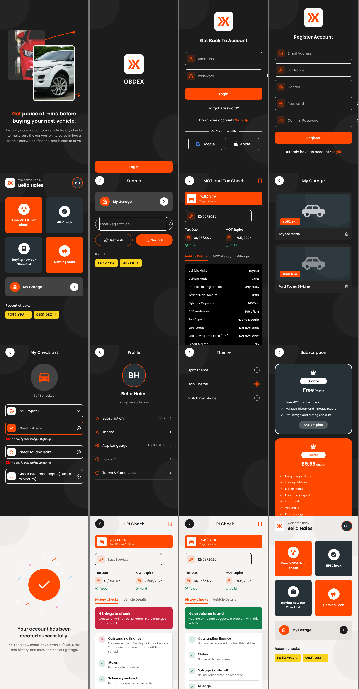

# OBDEX

UK vehicle MOT, tax and HPI checks.

| Folder | What it is |
| --- | --- |
| [`obdex-mobile`](obdex-mobile) | The Android and iPhone app (Expo / React Native) |
| [`obdex-app`](obdex-app) | The server that holds the DVSA, DVLA and HPI keys, plus a web version of the app |

## Android APK

**Download the latest build:** [OBDEX.apk](https://github.com/Fudgeamin99/OBDEX/releases/download/android-latest/OBDEX.apk). Open the link on your Android phone and install it (allow installs from your browser if asked).

Every push to `main` that changes `obdex-mobile` builds a new APK with GitHub Actions and replaces that download. The build is also kept under Artifacts: open the **Actions** tab, choose the latest **Android APK** run and download **obdex-android-apk** under Artifacts. You can also start a build by hand from the same page with **Run workflow**.

